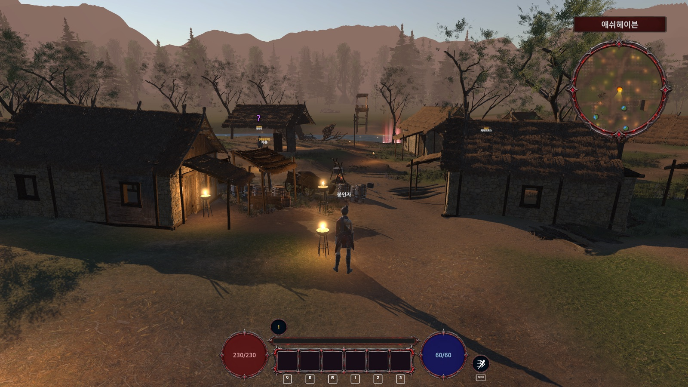
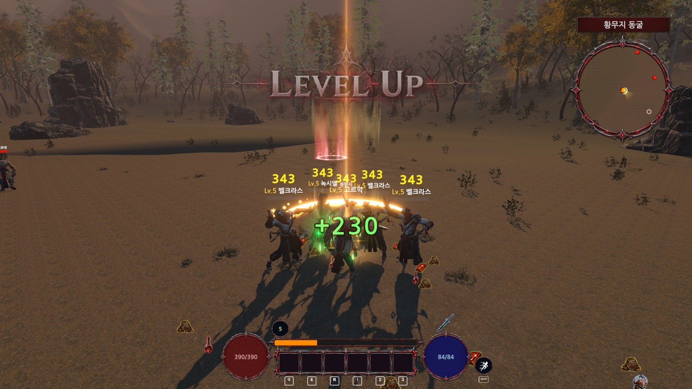
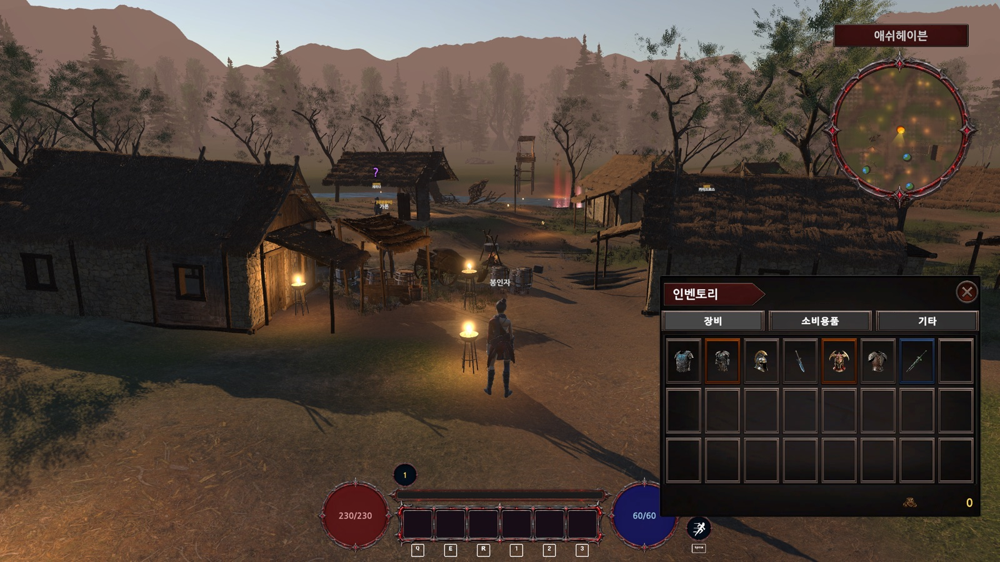
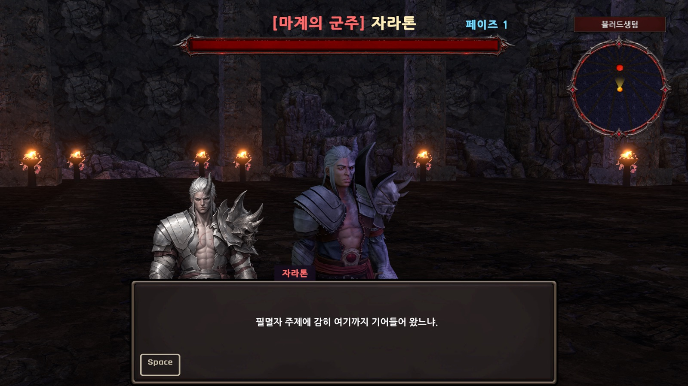

# Blood Sanctum (블러드 생츄어리)

[English](README.md)

**Unity 6**(URP)로 혼자 만든 3D 액션 RPG입니다. 서로 떨어진 다섯 개 구역을 돌파하며 레벨을 올리고, 장비를 모아 강화하고, 공격 패턴이 있는 두 보스를 쓰러뜨린 뒤 성소를 봉인하면 이야기가 끝납니다.

이 저장소에는 **직접 작성한 C# 코드와 게임 데이터 에셋(ScriptableObject)만** 들어 있습니다. 아트·모델·애니메이션·VFX는 제가 재배포할 권리가 없는 외부 에셋 팩이라 포함하지 않았습니다([외부 에셋](#외부-에셋) 참고). 코드 리뷰용으로 공개한 저장소이며, 클론만으로는 플레이 가능한 프로젝트로 열리지 않습니다.

| | |
|---|---|
| 엔진 | Unity 6000.6.2f1, Universal Render Pipeline 17.6 |
| 언어 | C# — 16개 모듈, 약 29,000줄 (`Assets/RPGGame/Scripts`) |
| 입력 | Unity Input System |
| 플랫폼 | 스탠드얼론 (macOS 빌드 확인) |
| 담당 | 기획, 프로그래밍, 밸런싱, UI, 콘텐츠 전부 |

## 스크린샷

| | |
|---|---|
|  |  |
| 마을 거점: HUD, 미니맵, 퀵슬롯 | 헤이븐 러쉬로 무리를 타격: 피해 숫자, 레벨업 배너, 베기 이펙트 |
|  |  |
| 탭이 있는 인벤토리 (고정 칸, 드래그 배치) | 보스 조우: 이름·페이즈·체력바와 초상화 대사 |

## 게임 소개

- **전투:** 한손검 3타 콤보(마지막 타는 항상 치명타), 쿨타임이 있는 대시, 대상 쪽으로 방향을 보정하고 살짝 파고드는 공격 보조, 히트스톱·화면 흔들림·타격 불꽃으로 타격감을 줍니다.
- **스킬:** 액티브 스킬 4종과 궁극기 1종이 있고, 각각 4레벨까지 올릴 수 있습니다. 스킬 포인트로 배우고 퀵슬롯에 등록합니다.
- **장비:** 드랍되는 장비는 모두 개별 개체로, 능력치가 무작위로 정해지고 강화 단계도 개체마다 따로 갖습니다. 강화는 단계별 성공 확률과 재료·골드 비용이 있습니다.
- **성장:** 레벨, 스탯 포인트, 퀘스트(처치·수집·대화·튜토리얼), 상점, 대장장이, 전리품 드랍.
- **월드:** 텔레포트 네트워크로 이어진 독립 구역 5곳, 난이도가 단계별로 오르는 사냥터, 어두운 돔 던전, 공격 예고가 있는 보스 2종.
- **엔딩:** 블러드스톤으로 봉인의 왕좌를 봉인하면 연출이 나오고 마을로 돌아갑니다.

## 기술적으로 신경 쓴 부분

### 데이터 중심 설계
밸런스와 콘텐츠는 코드가 아니라 ScriptableObject에 있어서, 스크립트를 건드리지 않고 수정할 수 있습니다.
- 스킬 — [`SkillData`](Assets/RPGGame/Scripts/Skill/SkillData.cs)는 추상 기반 클래스이고 스킬마다 자식 클래스(`DashStrikeSkillData`, `LaserRainSkillData`, `UltimateBlastSkillData` 등)가 있습니다. 피해량은 `(고정 피해 + 공격력 × 계수) × 레벨 배율`이라 후반에 공격력이 올라도 스킬이 그대로 비례해 커지지 않습니다. 쿨타임은 레벨별로 지정할 수 있습니다.
- 보스 공격 — [`BossPatternData`](Assets/RPGGame/Scripts/Monsters/Boss/Data/BossPatternData.cs) 자식 클래스들(돌진, 콤보, 냉기 부채꼴, 직선 분출, 메테오, 투사체, 충격파, 소환, 순간이동 공격, 지속 장판)로 구성됩니다. 보스는 패턴 에셋 목록과 페이즈 규칙의 조합입니다.
- 아이템, 강화 표, 상점 가격, 퀘스트, NPC 대사, 몬스터 능력치, 레벨별 플레이어 능력치는 모두 [`Assets/RPGGame/Data`](Assets/RPGGame/Data)와 [`Resources/Data`](Assets/RPGGame/Resources/Data) 아래의 에셋입니다.

### 전투 구조
- [`Damageable`](Assets/RPGGame/Scripts/Core/Damageable.cs)가 모든 피해의 단일 입구입니다. 무적 시간, [`DamageFormula`](Assets/RPGGame/Scripts/Core/DamageFormula.cs)에 의한 방어력 반영(뺄셈이 아닌 비율 감소), 치명타 표시, 넉백, 이미 죽은 대상 거부를 한곳에서 처리합니다.
- [`HPController`](Assets/RPGGame/Scripts/Core/HPController.cs)는 체력을 들고 피해·회복·사망 이벤트를 알립니다. 사망 후 시체를 계속 때려도 사망 처리가 다시 일어나지 않도록 한 번만 발행하는 보호 장치가 있고, "사망 시 1회 부활" 같은 효과를 끼워 넣는 훅도 있습니다.
- 이벤트 기반 연결(UnityEvent와 코드 구독)로 체력바·피해 숫자·타격 효과·퀘스트 집계·전리품 드랍이 전투 코드와 서로 엮이지 않게 했습니다.

### 상태 머신
- 플레이어 — [`PlayerStateManager`](Assets/RPGGame/Scripts/Player/State/PlayerStateManager.cs)가 Idle / Move / Roll / Attack / Dead를 관리합니다. 공격 타이밍은 애니메이션 이벤트와 `StateMachineBehaviour`로 구동해서 타격 판정이 클립과 맞습니다.
- 몬스터·보스 — 몬스터는 Idle / Patrol / Chase / Attack / Dead, 보스는 여기에 Heal과 PhaseTransition이 더해지고, 패턴은 공용 [`BossPatternContext`](Assets/RPGGame/Scripts/Monsters/Boss/Data/BossPatternContext.cs)를 통해 실행합니다.

### 시스템
- **인벤토리** — 탭마다 고정 칸을 드래그로 배치합니다. 다른 아이템이 사라져도 각자 칸을 유지하고, 장비 교체는 같은 칸에서 맞바뀝니다. [`UIInventoryWindow`](Assets/RPGGame/Scripts/UI/Windows/Inventory/UIInventoryWindow.cs) 참고.
- **장비 개체** — [`EquipmentInstance`](Assets/RPGGame/Scripts/Item/EquipmentInstance.cs)가 공통 아이템 정의와 드랍마다 다른 능력치·강화 단계를 분리합니다.
- **스폰** — [`MonsterSpawner`](Assets/RPGGame/Scripts/Monsters/MonsterSpawner.cs)는 개체 수 상한과 일괄 리스폰을, [`HuntingGroundSpawner`](Assets/RPGGame/Scripts/Monsters/HuntingGroundSpawner.cs)는 구역별 고정 개체 수를 유지하며 특정 퀘스트 진행 중에는 수를 줄일 수 있습니다.
- **저장/불러오기** — JSON 저장([`SaveManager`](Assets/RPGGame/Scripts/Save/SaveManager.cs), [`GameSaveLoader`](Assets/RPGGame/Scripts/Save/GameSaveLoader.cs))이 능력치·인벤토리·장비 개체·퀘스트·스킬을 담고, 이전 저장 형식을 변환합니다.
- **UI** — 약 70개 스크립트: Esc로 닫는 창 스택, 아이템·스킬 툴팁, 퀘스트 추적창과 미니맵, 선입선출 3줄 피해 숫자, 시스템 메시지, 초상화가 있는 대화.
- **개발 도구** — [`GameTestTools`](Assets/RPGGame/Scripts/Dev)가 아이템 지급, 퀘스트 완료, 텔레포트, 보스 처치 같은 디버그 단축키를 제공해 어느 구간이든 빠르게 테스트할 수 있습니다.

## 저장소 구조

```
Assets/RPGGame/
├── Scripts/
│   ├── Audio/ Core/ Dev/ Effects/ Interaction/
│   ├── Item/ Monsters/ NPC/ Player/ Quest/
│   ├── Save/ Settings/ Shop/ Skill/ UI/ World/
├── Data/            ScriptableObject 데이터 (스킬, 아이템, 보스 패턴, 상점, 강화)
└── Resources/Data/  런타임 로드 데이터 (플레이어 레벨, 몬스터, 퀘스트, NPC, 아이템 DB)
Packages/manifest.json
ProjectSettings/ProjectVersion.txt
```

## 외부 에셋

이 저장소에는 포함하지 않았습니다. 게임은 다음 에셋을 사용합니다: Hovl Studio와 Eric VFX Studio 이펙트, EEJANAI 무료 검 애니메이션, MS WeaponVol01 무기 모델, Mixamo 캐릭터 애니메이션, ParticlePro FX, Gabriel Aguiar Productions VFX, Bandits Valley 환경 팩, ForestVision, Rocks and Boulders 2, Footsteps – Essentials, 입력 아이콘 팩, 나눔고딕 글꼴. 각 에셋의 권리는 제작자에게 있으며 각자의 라이선스를 따릅니다.

## 실행 방법

스크립트는 Unity **6000.6.2f1** 기준입니다. 코드는 어떤 에디터로든 열어서 볼 수 있고, 게임을 실행하려면 위 외부 에셋을 같은 버전의 프로젝트에 직접 임포트해야 합니다.
