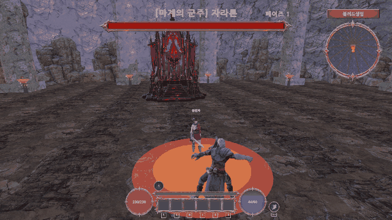

# Blood Sanctum (블러드 생츄어리)

[English](README.md)

**Unity 6 (URP)** 로 혼자 만든 3D 액션 RPG. 구역 5곳, 3타 콤보, 스킬 5종, 능력치가 무작위로 정해지는 장비와 강화, 공격 패턴이 있는 보스 2종을 담았습니다.



> **소스 전용 저장소입니다.** 직접 만든 C# 코드와 게임 데이터 에셋만 있습니다. 외부 아트·모델·VFX는 포함하지 않아서, 실행용이 아니라 코드 리뷰용입니다.

| | |
|---|---|
| **엔진** | Unity 6000.6.2f1 · URP 17.6 · Input System |
| **코드** | C# 약 29,000줄, 16개 모듈 (`Assets/RPGGame/Scripts`) |
| **담당** | 1인 개발: 기획, 프로그래밍, 밸런싱, UI, 콘텐츠 |
| **빌드** | 스탠드얼론 macOS |

## 핵심

- **데이터 중심** — 스킬·보스 공격·아이템·강화·퀘스트·상점이 ScriptableObject라서, 콘텐츠를 늘릴 때 코드가 아니라 에셋만 추가합니다.
- **단일 피해 처리** — `Damageable` 한 곳에서 무적 시간, 방어력, 치명타, 넉백을 처리합니다.
- **패턴 기반 보스** — 보스는 공격 패턴 에셋의 목록이고, 예고 표시와 페이즈가 있습니다.
- **개체별 장비** — 드랍마다 능력치와 강화 단계가 따로 정해집니다.
- **완결된 흐름** — 퀘스트, 상점, 강화, 텔레포트 네트워크, 저장/불러오기, 엔딩까지 이어집니다.

## 스크린샷

<table>
<tr>
<td></td>
<td></td>
</tr>
<tr>
<td align="center">마을 거점: HUD와 미니맵</td>
<td align="center">헤이븐 러쉬: 피해 숫자, 베기 이펙트</td>
</tr>
<tr>
<td></td>
<td></td>
</tr>
<tr>
<td align="center">탭 인벤토리: 고정 칸, 드래그 배치</td>
<td align="center">보스 조우: 페이즈와 체력바</td>
</tr>
</table>

## 시스템

| 시스템 | 위치 | 내용 |
|---|---|---|
| 전투 | `Core/`, `Player/` | 3타 콤보(마지막 타는 항상 치명타), 대시, 공격 보조, 히트스톱 |
| 스킬 | `Skill/` | 스킬 4종 + 궁극기, 4레벨, 레벨별 쿨타임, 스킬 치명타 |
| 보스 | `Monsters/Boss/` | 패턴 10종, 예고 표시, 페이즈 전환, 공용 패턴 컨텍스트 |
| 아이템 | `Item/`, `Player/` | 개체별 능력치, 강화 확률·비용, 고정 칸 인벤토리 |
| 퀘스트·NPC | `Quest/`, `NPC/` | 처치·수집·대화·튜토리얼 퀘스트, 초상화 대사 |
| 월드 | `World/`, `Monsters/` | 구역 5곳, 텔레포트 네트워크, 개체 수 상한이 있는 스포너 |
| 저장 | `Save/` | JSON 저장/불러오기, 이전 형식 변환 |
| UI | `UI/` | 약 70개 스크립트: 창 스택(Esc), 툴팁, 미니맵, 3줄 피해 숫자 |
| 개발 도구 | `Dev/` | 아이템·퀘스트·텔레포트·보스용 디버그 단축키 |

## 구조

```
Assets/RPGGame/
├── Scripts/         C# 소스 (Audio · Core · Dev · Effects · Item · Monsters · NPC · Player · Quest · Save · Shop · Skill · UI · World)
├── Data/            ScriptableObject: 스킬, 아이템, 보스 패턴, 상점, 강화
└── Resources/Data/  런타임 데이터: 플레이어 레벨, 몬스터, 퀘스트, NPC, 아이템 DB
```

## 외부 에셋 (미포함)

Hovl Studio·Eric VFX Studio 이펙트, EEJANAI 검 애니메이션, MS WeaponVol01 무기 모델, Mixamo 애니메이션, ParticlePro FX, Gabriel Aguiar Productions VFX, Bandits Valley, ForestVision, Rocks and Boulders 2, Footsteps – Essentials, 입력 아이콘 팩, 나눔고딕 글꼴. 모든 권리는 각 제작자에게 있습니다.
