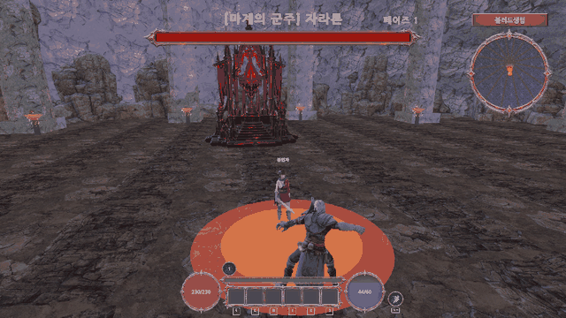
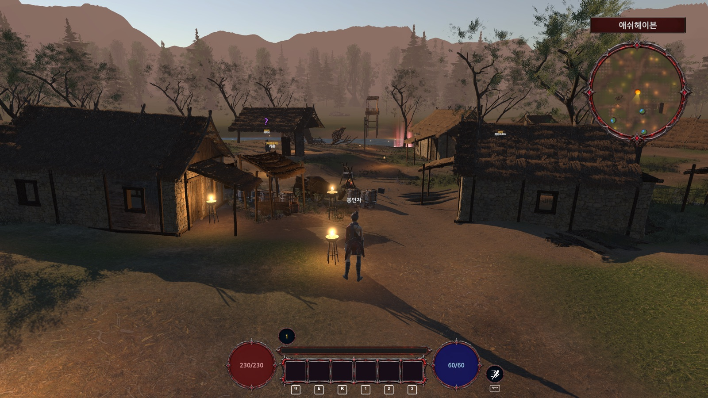
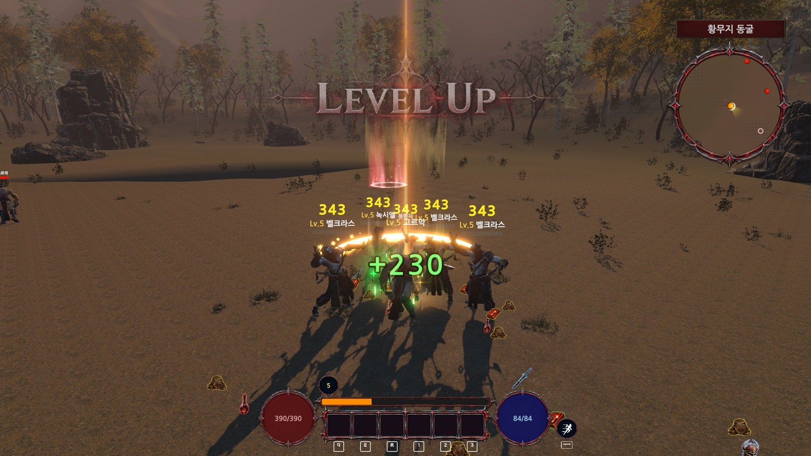
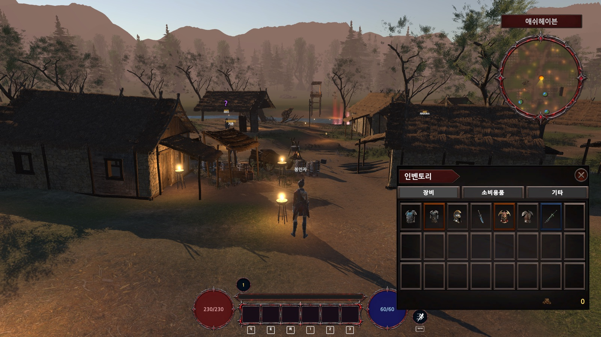
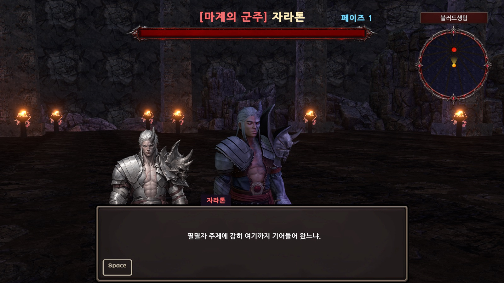
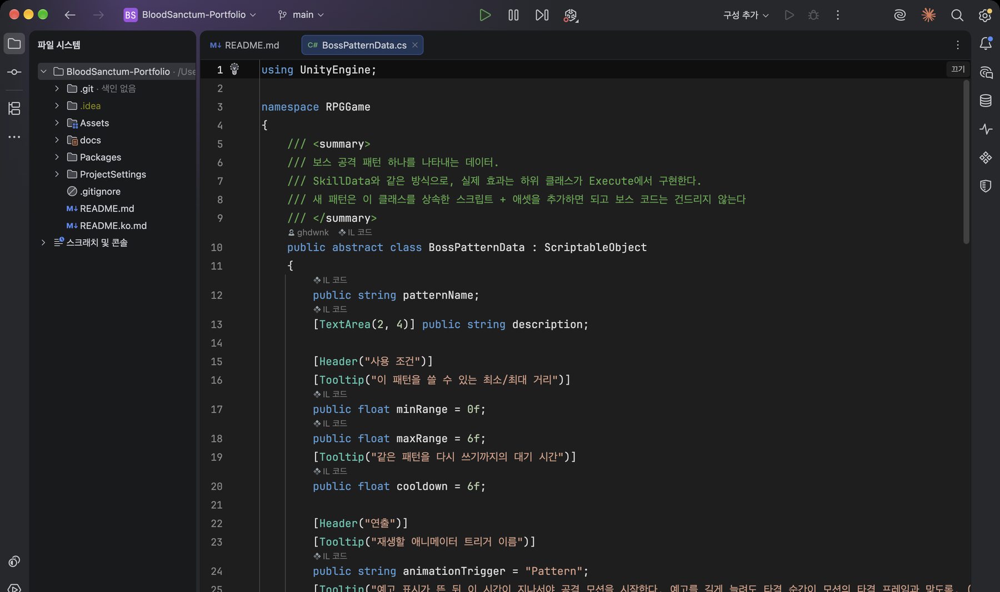
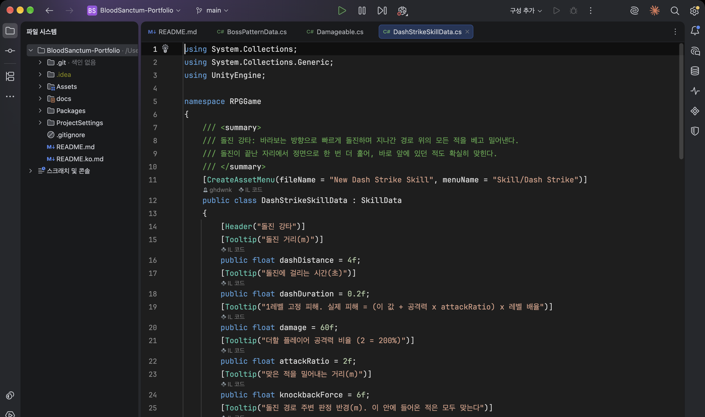
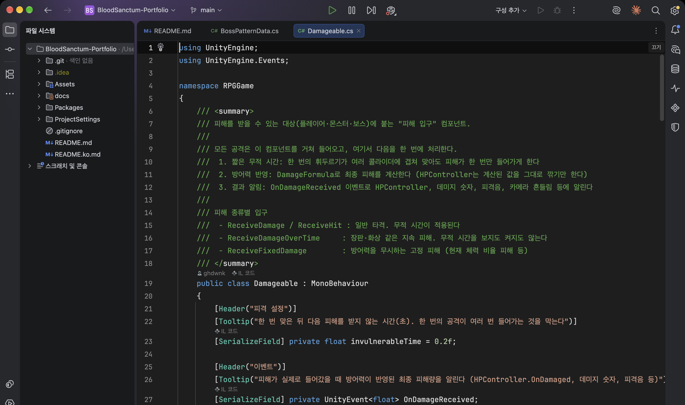
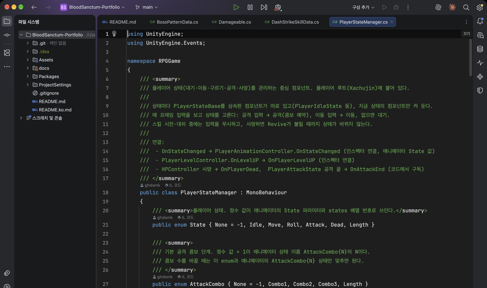

# Blood Sanctum

[한국어](README.ko.md)

A 3D action RPG built solo in **Unity 6 (URP)**: five zones, a three-hit combo, five skills, randomized gear with enhancement, and two pattern-driven bosses.



> **Source-only repository.** It holds my C# code and game-data assets. Third-party art, models and VFX are not included, so it is for code review rather than for running.

| | |
|---|---|
| **Engine** | Unity 6000.6.2f1 · URP 17.6 · Input System |
| **Code** | C#, ~29,000 lines, 16 modules (`Assets/RPGGame/Scripts`) |
| **Role** | Solo: design, programming, balancing, UI, content |
| **Build** | Standalone macOS |

## Highlights

- **Data-driven** — skills, boss attacks, items, enhancement, quests and shops are ScriptableObjects; new content needs an asset, not a code change.
- **One damage pipeline** — a single `Damageable` entry point handles invulnerability, defense, crits and knockback.
- **Pattern-based bosses** — a boss is a list of attack-pattern assets with telegraphs and phases.
- **Per-drop equipment** — every drop has its own rolled stats and enhancement level.
- **Complete loop** — quests, shops, enhancement, teleport network, save/load and an ending.

## Screenshots

<table>
<tr>
<td></td>
<td></td>
</tr>
<tr>
<td align="center">Village hub with HUD and minimap</td>
<td align="center">Dash Strike: damage numbers, slash VFX</td>
</tr>
<tr>
<td></td>
<td></td>
</tr>
<tr>
<td align="center">Tabbed inventory, fixed draggable slots</td>
<td align="center">Boss encounter with phase and HP bar</td>
</tr>
</table>

## Code design

Four files that show how the project is structured (captured in Rider).

<table>
<tr>
<td width="50%"></td>
<td width="50%"></td>
</tr>
<tr>
<td><b><a href="Assets/RPGGame/Scripts/Monsters/Boss/Data/BossPatternData.cs">BossPatternData</a></b><br>Abstract ScriptableObject. Each attack is a subclass plus an asset; boss code never changes.</td>
<td><b><a href="Assets/RPGGame/Scripts/Skill/DashStrikeSkillData.cs">DashStrikeSkillData</a></b><br>Skills derive from <code>SkillData</code>. Damage is <code>(flat + attack × ratio) × level</code>, so late-game attack does not scale skills linearly.</td>
</tr>
<tr>
<td width="50%"></td>
<td width="50%"></td>
</tr>
<tr>
<td><b><a href="Assets/RPGGame/Scripts/Core/Damageable.cs">Damageable</a></b><br>The single entry for all damage: invulnerability window, defense, crit flag, events. <code>HPController</code> only subtracts and reports.</td>
<td><b><a href="Assets/RPGGame/Scripts/Player/State/PlayerStateManager.cs">PlayerStateManager</a></b><br>One component per state; only the active one runs. Combo count is an enum plus animator states.</td>
</tr>
</table>

## Systems

| System | Where | Notes |
|---|---|---|
| Combat | `Core/`, `Player/` | 3-hit combo (finisher always crits), dash, aim assist, hit stop |
| Skills | `Skill/` | 4 skills + ultimate, 4 levels, per-level cooldowns, skill crits |
| Bosses | `Monsters/Boss/` | 10 pattern types, telegraphs, phase transitions, shared pattern context |
| Items | `Item/`, `Player/` | Per-drop stats, enhancement odds and costs, fixed-slot inventory |
| Quests & NPCs | `Quest/`, `NPC/` | Kill / collect / talk / tutorial quests, dialogue with portraits |
| World | `World/`, `Monsters/` | 5 zones, teleport network, spawners with population caps |
| Save | `Save/` | JSON save/load with legacy-format conversion |
| UI | `UI/` | ~70 scripts: window stack (Esc), tooltips, minimap, 3-line damage text |
| Dev tools | `Dev/` | Debug hotkeys for items, quests, teleport and bosses |

## Layout

```
Assets/RPGGame/
├── Scripts/         C# source (Audio · Core · Dev · Effects · Item · Monsters · NPC · Player · Quest · Save · Shop · Skill · UI · World)
├── Data/            ScriptableObjects: skills, items, boss patterns, shop, enhancement
└── Resources/Data/  Runtime data: player levels, enemies, quests, NPCs, item database
```

## Third-party assets (not included)

Hovl Studio and Eric VFX Studio effects, EEJANAI sword animations, MS WeaponVol01 weapon models, Mixamo animation, ParticlePro FX, Gabriel Aguiar Productions VFX, Bandits Valley, ForestVision, Rocks and Boulders 2, Footsteps – Essentials, input icon packs, and the Nanum Gothic font. All remain the property of their creators.
